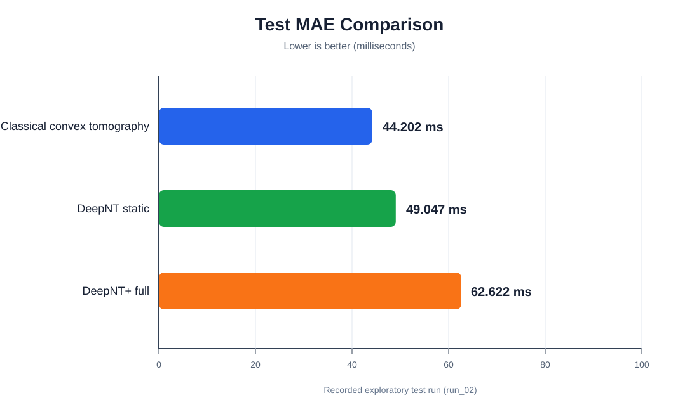

# DeepNT+

DeepNT+ is a hybrid, path-centric network tomography model for estimating the
round-trip time (RTT) of hidden network paths from network topology, structural
features, observed path RTTs, tomography relationships, and optional temporal
context.

> **Research status:** The recorded real-data result is exploratory. The saved
> `run_02` output has a monitor/vantage-point shift: validation and test contain
> only `dac-bd`, while training contains all monitors. The results should be
> rerun with a verified split before being treated as final thesis results.

## Research task

Given a network graph and RTT measurements for observed paths, the model predicts
RTT for hidden paths without using hidden RTT as an input at validation or test
time. Hidden RTT is used only for training loss and evaluation.

## Main components

- Structural graph neural network
- Ordered path encoder with positional embeddings and Transformer attention
- Tomography layer using path-edge incidence
- Convex refinement using observed paths
- Learned fusion of convex and neural estimates
- Optional temporal branch with node memory and recent-history encoding
- Optional uncertainty estimation and active-learning simulation

## Repository structure

| Path | Purpose |
|---|---|
| `Dataset_Build.ipynb` | Builds the strict real-ITDK dataset |
| `DeepNT_Plus.ipynb` | Runs training, evaluation, baselines, and ablations |
| `deepnt_plus/` | DeepNT+ implementation and experiment utilities |
| `tests/` | Synthetic tests for data, models, causality, metrics, and evaluation |
| `DEEPNT_PLUS_COMPLETE_STATUS_REPORT.md` | Detailed implementation and experiment status |
| `results/deepnt_plus_test_mae.svg` | Output comparison chart |

## Recorded test results

The following are from the current exploratory test run. Lower MAE and RMSE are
better; higher R² is better.

| Model | Test MAE (ms) | Test RMSE (ms) | Test R² |
|---|---:|---:|---:|
| Classical convex tomography | **59.555** | **200.634** | **0.047** |
| DeepNT static | 65.676 | 202.726 | 0.027 |
| DeepNT+ full | 74.105 | 207.220 | -0.017 |



The current result shows that the simpler DeepNT static model outperforms the
full DeepNT+ model on this recorded test split. DeepNT+ should therefore be
improved and re-evaluated rather than presented as the final best model.

## Ablation results

| Variant | Test MAE (ms) |
|---|---:|
| DeepNT+ without temporal branch | 77.002 |
| DeepNT+ uncertainty ablation | 80.625 |
| DeepNT+ context-feature ablation | 81.112 |
| DeepNT+ convex-fusion ablation | 84.376 |
| DeepNT+ tomography ablation | 105.303 |

## Evaluation criteria

The primary performance metric is **test MAE**:

- DeepNT+ current baseline: `74.105 ms`
- DeepNT static target to beat: `65.676 ms`
- Classical convex tomography target to beat: `59.555 ms`

An improved model should also reduce test RMSE below `207.220 ms`, increase test
R² above `-0.017`, and maintain stable results across multiple random seeds.

## Running the tests

From the repository root:

```powershell
python tests/test_deepnt_plus.py
```

## Reproducibility and next steps

1. Rebuild or verify the processed dataset.
2. Confirm train, validation, and test monitor identities and counts.
3. Run a clearly labeled leave-monitor-out experiment.
4. Compare DeepNT+, DeepNT static, and classical convex tomography on the same
   verified split.
5. Save each new run in a new output directory instead of overwriting `run_02`.

See [DEEPNT_PLUS_COMPLETE_STATUS_REPORT.md](DEEPNT_PLUS_COMPLETE_STATUS_REPORT.md)
for the complete status, data construction details, architecture notes, and
methodological limitations.
