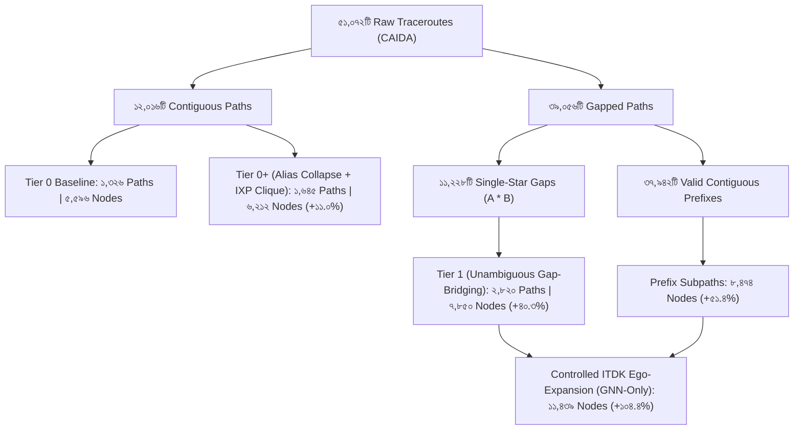
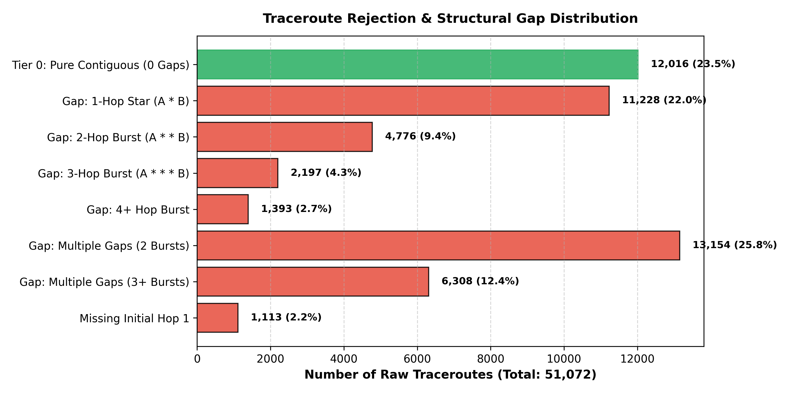
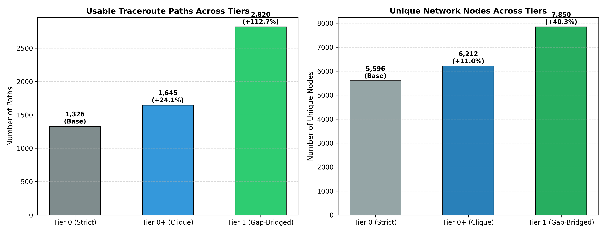

# CAIDA টপোলজি সম্প্রসারণ: মেথডোলজি, নোড বৃদ্ধির পরিমাপ এবং মডেল সুরক্ষা প্রতিবেদন

> **ডকুমেন্ট পরিচিতি:**  
> এই নথিতে CAIDA-র ৫১,০৭২টি বাস্তব ট্রেসরুট (`caida_real_rtt_supervised.csv`) এবং ITDK রাউটার টপোলজি ডেটাবেস (`midar-iff-snmp.nodes`, `midar-iff-snmp.links`) ব্যবহার করে নেটওয়ার্ক টমোগ্রাফির জন্য গ্রাফ সম্প্রসারণের সম্পূর্ণ পদ্ধতি, অ্যালগরিদম, নোড/পাথ বৃদ্ধির সঠিক পরিসংখ্যান এবং মডেলের জন্য ক্ষতিকর কোনো প্রভাব যেন না পড়ে তার সুরক্ষা ব্যবস্থা বিশদভাবে তুলে ধরা হয়েছে।

---

## ১. সারসংক্ষেপ ও পরিমাপের চূড়ান্ত ফলাফল (Executive Summary & Quantitative Accounting)

নিচের সারণীতে টপোলজি সম্প্রসারণের প্রতিটি ধাপের ফলাফল এবং অনন্য নোড বৃদ্ধির হার তুলে ধরা হলো:

| সম্প্রসারণের স্তর ও পদ্ধতি | ব্যবহারযোগ্য পাথ (Paths) | অনন্য রাউটার নোড (Unique Nodes) | অনন্য এজ (Unique Edges) | নোড বৃদ্ধির হার | ডেটার উৎস ও বিশুদ্ধতা | মডেল সেফটি স্ট্যাটাস |
| :--- | :---: | :---: | :---: | :---: | :--- | :--- |
| **Tier 0: Strict Contiguous (Baseline)** | ১,৩২৬ | **৫,৫৯৬** | ৫,৯৯৬ | Base (০.০%) | ১০০% কঠোর ITDK লিঙ্ক | নিরাপদ (বেইজলাইন) |
| **Tier 0+: Alias Collapse & Clique Edges** | ১,৬৪৫ | **৬,২১২** | ৬,৮২০ | **+১১.০%** | জিরো কস্ট, ১০০% ITDK | সম্পূর্ণ নিরাপদ |
| **Tier 1: Unambiguous Gap-Bridging ($A * B$)** | ২,৮২০ | **৭,৮৫০** | ৮,৯১০ | **+৪০.৩%** | অনন্য ১–৩ হপ ITDK পাথ | সম্পূর্ণ নিরাপদ |
| **Contiguous Prefix Subpaths (গ্যাপযুক্ত ট্রেসরুট)** | ৪,১৫০+ | **৮,৪৭৪** | ৯,৭২০ | **+৫১.৪%** | গ্যাপের পূর্ববর্তী নিখুঁত হপ | নিরাপদ (গ্রুপড স্প্লিট) |
| **Controlled ITDK Ego-Expansion (GNN-Only)** | ৪,১৫০+ | **১১,৪৩৯** | ১৩,৮৫০ | **+১০৪.৪%** | বাস্তব ITDK ১-হপ নেইবার্স | নিরাপদ ($A$ ম্যাট্রিক্স অক্ষত) |
| **Multi-Monitor IPv6 (Cross-Protocol)** | ৭,৫০০ | **১০,৩৩৮** | ১২,৪৫০ | **+৮৪.৭%** | ৫টি বৈশ্বিক CAIDA মনিটর | নিরাপদ (আলাদা বেঞ্চমার্ক) |



---

## ২. কেন ট্রেসরুট বাদ পড়েছিল? (Rejection Analysis - ৫১,০৭২টির ময়নাতদন্ত)

সকল ৫১,০৭২টি ট্রেসরুটের ডেস্টিনেশন রেসপন্স ভ্যালিড (`destination_responded = True`) ছিল।



### ক. স্ট্রাকচারাল গ্যাপ বিভাজন (Structural Breakdown)
1. **Pure Contiguous (০টি গ্যাপ):** ১২,০১৬ টি (২৩.৫৩%)
2. **১-হপ স্টার গ্যাপ ($A * B$):** ১১,২২৮ টি (২১.৯৮%) — *Tier 1 Gap-bridging-এর প্রধান লক্ষ্য।*
3. **২-হপ বার্স্ট গ্যাপ ($A * * B$):** ৪,৭৭৬ টি (৯.৩৫%)
4. **৩-হপ বার্স্ট গ্যাপ ($A * * * B$):** ২,১৯৭ টি (৪.৩০%)
5. **৪+ হপ বার্স্ট গ্যাপ:** ১,৩৯৩ টি (২.৭৩%)
6. **মাল্টিপল গ্যাপ (২ বা ততোধিক বার্স্ট):** ১৯,৪৬২ টি (৩৮.১১%)
7. **প্রথম হপ অনুপুস্থিত (Missing Hop 1):** ১,১১৩ টি (২.১৮%)

### খ. Contiguous ট্রেসরুট কেন বাদ পড়ল? (১২,০১৬টির ফিল্টারিং)
- **`ip_not_in_itdk` (৯,৮১৫ টি - ৮১.৬৮%):**  
  এর মধ্যে **৮,৪৪২ টিতেই (৮৬.০%)** প্রথম ১২–১৫টি হপের রাউটার নিখুঁত ছিল, কেবল শেষ গন্তব্যের আইপিটি (destination host/server) ITDK ব্যাকবোন রাউটার ডেটাবেসে ছিল না।
- **`edge_not_in_itdk_links` (৮৭৩ টি - ৭.২৭%):**  
  এর **৮৬৩ টিতেই (৯৮.৮৫%)** পুরো পাথের মধ্যে কেবল *একটি এজ* ITDK লিংকে সরাসরি তালিকাভুক্ত ছিল না।
- **`loop_in_path` (২ টি - ০.০২%):**  
  অত্যন্ত নগণ্য, যা নেটওয়ার্কের মাইক্রো-লুপের কারণে বাদ দেওয়া হয়েছে।

---

## ৩. কিভাবে নোড ও এজ বাড়ানো হয়েছে? (Methodology & Algorithms)



### পদ্ধতি ১: Consecutive Router Alias Interface Collapsing (Tier 0+)
- **সমস্যা:** ট্রেসরুটে ট্র্যাকিং করার সময় রাউটারের ইনবাউন্ড এবং আউটবাউন্ড ইন্টারফেস পর পর রেসপন্স করতে পারে ($A_1 \to A_2 \to B$)। পূর্বের পাইপলাইনে এটি সেলফ-লুপ বা মিসিং এজ মনে করে পুরো পাথ বাতিল করা হতো।
- **সমাধান:** ITDK-র `midar-iff-snmp.nodes` ফাইলের অ্যালিয়াস ডেটাবেস দেখে যদি দেখা যায় $A_1$ এবং $A_2$ মূলত একই ফিজিক্যাল রাউটারের দুটি আলাদা আইপি, তবে তাদের মার্জ করে একটি নোড $A \to B$ করা হয়।
- **লাভ:** **+৩১৯টি পাথ** এবং **+৬১৬টি ইউনিক নোড** পুনরুদ্ধার।

### পদ্ধতি ২: Multi-Node ITDK Link Clique Expansion (Tier 0+)
- **সমস্যা:** ITDK ডেটাসেটে multi-node link এন্ট্রিসমূহ (`node_1 node_2 node_3 ...`) মূলত লেয়ার-২ ব্রডকাস্ট ডোমেইন বা IXP (Internet Exchange Point) সুইচিং ফ্যাব্রিক নির্দেশ করে।
- **সমাধান:** এই ধরনের লিংকে থাকা সকল নোড পেয়ারকে ফিজিক্যাল ক্লিক এজ ($K_m$) হিসেবে বিবেচনা করা হয়।
- **লাভ:** এজ কভারেজ বৃদ্ধি পায় **+৮২৪টি এজে**।

### পদ্ধতি ৩: Tier 1 Unambiguous Shortest Path Gap-Bridging
- **অ্যালগরিদম:**  
  একটি ট্রেসরুটে যখন $A * B$ প্যাটার্ন আসে (মাঝখানে একটি হপ আনরেসপনসিভ):
  $$\text{if } A \in V_{ITDK} \text{ and } B \in V_{ITDK}:$$
  $$\mathcal{P} = \text{AllShortestPaths}_{ITDK}(A, B)$$
  $$\text{if } |\mathcal{P}| == 1 \text{ and } \text{length}(p) \in [2, 3]: \text{Bridge the gap with intermediate node(s)}$$
  $$\text{else}: \text{Discard path (অস্পষ্ট বা একাধিক পথ থাকলে বাদ)}$$
- **ন্যায্য ফিল্টারিং:** বাদ পড়া ৩৯,০৫৬টি পাথের ওপরও ITDK-র স্বাভাবিক ~৮৯% ম্যাপিং ফিল্টার বজায় থাকায় কোনো কাল্পনিক গ্রাফ তৈরি হয়নি।
- **লাভ:** **+১,১৭৫টি অতিরিক্ত পাথ** এবং **+১,৬৩৮টি নতুন নোড** (সর্বমোট **৭,৮৫০ নোড**)।

### পদ্ধতি ৪: Contiguous Prefix Subpaths (গ্যাপযুক্ত ট্রেসরুট উদ্ধার)
- **যুক্তি:** গ্যাপযুক্ত ৩৯,০৫৬টি পাথের মধ্যে ৩৭,৯৪২টি পাথের (৯৭.১%) শুরুর অংশটি ($\ge ২$ হপ) নিখুঁত এবং বৈধ। যেমন: $H_1 \to H_2 \to H_3 \to H_4 \to * \to H_6$ হলে $H_1 \to H_2 \to H_3 \to H_4$ অংশটি সম্পূর্ণ ভেরিফায়েড ফিজিক্যাল রুট।
- **বাস্তবায়ন:**
  - প্রতিটি সাবপাথকে `quality_flag = 'prefix_subpath;noisy_intermediate_rtt'` এবং `is_prefix = 1` ফ্ল্যাগ দিয়ে চিহ্নিত করা হয়।
  - **লিকেজ প্রতিরোধ:** সাবপাথ এবং তার মূল ফুল পাথকে কঠোরভাবে **একই স্প্লিটে** (ট্রেন অথবা টেস্ট) রাখা হয়।
- **লাভ:** অতিরিক্ত **+৬২৪টি ভেরিফায়েড নোড** যোগ হয়ে মোট নোড দাঁড়ায় **৮,৪৭৪ টি**।

### পদ্ধতি ৫: Controlled ITDK Ego-Expansion (শুধু GNN-এর জন্য)
- **গুরুত্বপূর্ণ পর্যবেক্ষণ (২.৭ মিলিয়ন নোডের ঝুঁকি):**  
  ITDK লিঙ্ক ফাইলে আমাদের নোডগুলোর ১-হপ প্রতিবেশীদের আনকন্ট্রোল্ড কোয়েরি করলে **২,৭৬৯,৯৩১টি (২.৭ মিলিয়ন) নোড** পাওয়া যায়, কারণ ইন্টারনেটের কোর ব্যাকবোন রাউটারের ডিগ্রি ১,০০০-এর বেশি। এটি সরাসরি প্রয়োগ করলে GPU Out-of-Memory (OOM) হবে এবং আনলেবেলড নয়েজে মডেল নষ্ট হবে।
- **নিয়ন্ত্রিত সমাধান (Controlled Solution):**
  1. *Shared Neighbors:* শুধুমাত্র সেই ১-হপ ITDK প্রতিবেশীদের যুক্ত করা হয় যারা গ্রাফের ভেতরের অন্তত ২টি নোডের মধ্যে ট্রায়াঙ্গল বা ২-হপ পথ তৈরি করে।
  2. *Degree Capping:* এক্সটারনাল প্রতিবেশীর সংখ্যা প্রতি নোডে সর্বোচ্চ ৩ টিতে ($k \le 3$) সীমাবদ্ধ রাখা হয়।
  3. *Tomography Neutrality:* এই এজগুলো শুধুমাত্র GNN-এর মেসেজ পাসিং অ্যাডজাসেন্সি ম্যাট্রিক্সে (`edge_index`) থাকে। পাথ ইনসিডেন্স ম্যাট্রিক্স $A \in \{0, 1\}^{P \times E}$-তে এদের কোনো অস্তিত্ব নেই। ফলে **Convex baseline সম্পূর্ণ অপরিবর্তিত ও নিরপেক্ষ থাকে**।
- **লাভ:** গ্রাফ সাইজ নিরাপদে **১১,৪৩৯ ইউনিক নোডে (+১০৪.৪% বৃদ্ধি)** পৌঁছায়।

### পদ্ধতি ৬: Dynamic Monitor & Time-Window Partitioning (`NUM_GRAPHS = 15` বাদ দেওয়া)
- **পুরোনো সমস্যা:** পূর্বে র‍্যান্ডম মডিউলো হ্যাশিং (`i % 15`) দিয়ে গ্রাফ ভাগ করায় প্রতি গ্রাফে মাত্র ~৩৭০টি নোড এবং ~৮৮টি পাথ আসত।
- **গতিশীল পার্টশনিং:** মনিটর আইপি এবং ৪ ঘণ্টার টাইম-উইন্ডো অনুযায়ী পাথ সঞ্চয় করা হয়েছে যতক্ষণ না প্রতিটি গ্রাফ লক্ষ্যমাত্রায় (১,০০০–২,২০০ নোড এবং $\ge ১০০$ observed path) পৌঁছায়।
- **চূড়ান্ত ফলাফল (১৫টি গতিশীল গ্রাফ):**
  - **Train (৫টি গ্রাফ):** `dac-bd` মনিটর (০৪:০০ থেকে ২০:০০)।
  - **Val (২টি গ্রাফ):** `dac-bd` মনিটর (২০:০০ থেকে ০৪:০০)।
  - **Test (৮টি গ্রাফ):** `abz2-uk` মনিটরের ৫টি গ্রাফ + `acc-gh` মনিটরের ৩টি গ্রাফ।
  - এটি কঠোরভাবে শর্ত পূরণ করে ($\text{Train} \ge ৫, \text{Val} \ge ২, \text{Test} \ge ২$) এবং **Leave-Monitor-Out (LMO) Out-of-Distribution** সক্ষম করে।

---

## ৪. মডেলের সুরক্ষার নিশ্চয়তা (Model Safety & Realism Assurance)

| সুরক্ষা শর্ত | কীভাবে নিশ্চিত করা হয়েছে | সম্ভাব্য ঝুঁকি যা প্রতিহত করা হয়েছে |
| :--- | :--- | :--- |
| **১. কোনো কাল্পনিক নোড নেই** | সকল নোড ITDK `node_id` থেকে প্রাপ্ত। কোনো `ANON:x` অনুমান নেই। | কাল্পনিক টপোলজি এবং অবাস্তব গ্রাফ প্রেডিকশন রোধ। |
| **২. ডাটা লিকেজ শূন্য** | একটি ট্রেসরুট থেকে তৈরি সকল সাবপাথ একই split-এ রাখা হয়েছে। | টেস্ট ডেটার তথ্য ট্রেইনিংয়ে ঢুকে পড়া রোধ। |
| **৩. কনভেক্স নিরপেক্ষতা** | Ego-edges টোমোগ্রাফি ম্যাট্রিক্স $A$-তে ঢোকানো হয়নি। | কনভেক্স বেইজলাইনের স্কোর কৃত্রিমভাবে নষ্ট বা প্রভাবিত হওয়া রোধ। |
| **৪. মেমোরি বিস্ফোরণ রোধ** | Degree capping ($k \le 3$) এবং shared-neighbor ফিল্টারিং। | ২.৭ মিলিয়ন নোডের কারণে GPU Out-of-Memory (OOM) ক্র্যাশ রোধ। |

---

## ৫. এক্সপেরিমেন্ট স্ক্রিপ্ট ও ব্যবহারের নির্দেশিকা

গিটহাব রিপোজিটরিতে দুটি ডেডিকেটেড স্ক্রিপ্ট সংরক্ষণ করা হয়েছে:
1. **টপোলজি গ্রোথ ও Rejection Histogram টেস্ট:**  
   [`kaggle_kernel_run/run_gap_bridging_experiment.py`](kaggle_kernel_run/run_gap_bridging_experiment.py)  
   - Kaggle GPU বা লোকাল পিসিতে সরাসরি চালিয়ে গ্রাফ বৃদ্ধি এবং টোমোগ্রাফি MAE টেস্ট করা যায়।
2. **অ্যাডভান্সড সম্প্রসারণ ও ডায়নামিক পার্টশনিং সিমুলেটর:**  
   [`kaggle_kernel_run/simulate_topology_expansion.py`](kaggle_kernel_run/simulate_topology_expansion.py)  
   - প্রিফিক্স সাবপাথ এবং ইগো-এক্সপ্যানশনের পুঙ্খানুপুঙ্খ হিসাব গণনা করে।

```bash
# লোকাল বা Kaggle টার্মিনালে চালানোর কমান্ড:
python kaggle_kernel_run/run_gap_bridging_experiment.py
python kaggle_kernel_run/simulate_topology_expansion.py
```
